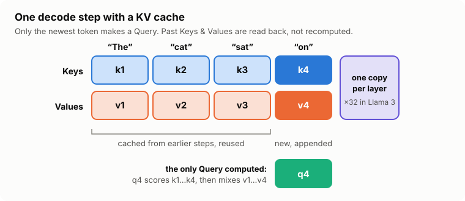

# 🚀 SGLang Guidance

**Clear, colourful explainers on LLM inference and serving with [SGLang](https://github.com/sgl-project/sglang), including on Intel GPUs.**

✍️ by **Ashwini Rathi** · [@arathi-hlab](https://github.com/arathi-hlab)

---

## 📚 Articles

| | Article | What you'll learn |
|---|---|---|
| 🧠⚡ | **[KV Caching, Explained](articles/kv-caching-explained.md)** | Why LLMs cache Keys & Values (not Queries), how it turns quadratic attention into linear, and what it costs in GPU memory, with Llama 3 8B numbers checked on an Arc Pro B60 |

<a href="articles/kv-caching-explained.md">
<picture>
  <source media="(prefers-color-scheme: dark)" srcset="assets/decode-step-dark.svg">
  
</picture>
</a>

---

## 🛣️ Coming next

- 🌳 RadixAttention: how SGLang shares KV cache across requests
- 🎛️ `--mem-fraction-static` and KV pool sizing, explained
- 🧮 KV cache quantization (fp8) and its trade-offs
- 🔷 Running SGLang on Intel XPU, step by step

---

### ⭐ If this helped you, please star the repo. It helps others find it!

