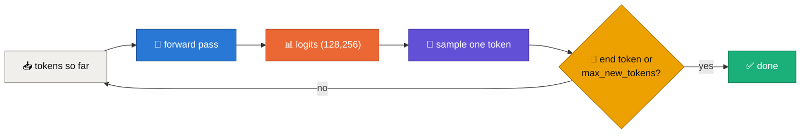

<div align="center">

# 🔤➡️🔢 Tokens, Embeddings & Logits
### How text becomes numbers, and numbers become the next word


✍️ by **Ashwini Rathi** · [@arathi-hlab](https://github.com/arathi-hlab)

<a href="https://github.com/arathi-hlab/sglang-guidance"></a>

</div>

<p align="center">🏠 <a href="../README.md">Roadmap</a> &nbsp;·&nbsp; <a href="02-inside-a-transformer-block.md">02 · Inside a transformer block</a> ➡️</p>

> [!TIP]
> **TL;DR:** An LLM never sees letters. Text is chopped into **tokens**, each token becomes a row of numbers (an **embedding**),
> the model transforms those rows, and at the end it scores **every token in its vocabulary** (the **logits**).
> Softmax turns the scores into probabilities, one token is picked, and the loop repeats.

---

## 🗺️ Contents

| | Section | | Section |
|---|---|---|---|
| 🔵 | [1. The whole pipeline in one picture](#-1-the-whole-pipeline-in-one-picture) | 🟣 | [5. From logits to probabilities](#-5-from-logits-to-probabilities) |
| 🟠 | [2. Tokens: chopping text into pieces](#-2-tokens-chopping-text-into-pieces) | 🔴 | [6. The generation loop](#-6-the-generation-loop) |
| 🟢 | [3. Embeddings: one row per token](#-3-embeddings-one-row-per-token) | 🔷 | [7. Try it with SGLang](#-7-try-it-with-sglang) |
| 🟡 | [4. Logits: scoring the whole vocabulary](#-4-logits-scoring-the-whole-vocabulary) | ⭐ | [Cheat sheet](#-cheat-sheet) |

---

## 🔵 1. The whole pipeline in one picture

```mermaid
flowchart LR
    T["📝 text<br/>'The cat sat on the'"]:::input --> TK["✂️ tokenizer"]:::step
    TK --> ID["🔢 token IDs<br/>[ ... ]"]:::ids
    ID --> E["📇 embedding lookup<br/>each ID → 4,096 numbers"]:::emb
    E --> B["🧱 32 transformer blocks<br/>(chapter 02)"]:::block
    B --> H["🎯 LM head<br/>4,096 → 128,256 scores"]:::head
    H --> P["🎚️ softmax → pick one"]:::pick
    P --> O["💬 ' mat'"]:::out
    classDef input fill:#f0efec,stroke:#898781,color:#0b0b0b
    classDef step fill:#6250d6,stroke:#3d2fa0,color:#ffffff
    classDef ids fill:#f0efec,stroke:#898781,color:#0b0b0b
    classDef emb fill:#1baf7a,stroke:#127a55,color:#ffffff
    classDef block fill:#2a78d6,stroke:#184f95,color:#ffffff
    classDef head fill:#eb6834,stroke:#b0461d,color:#ffffff
    classDef pick fill:#6250d6,stroke:#3d2fa0,color:#ffffff
    classDef out fill:#eda100,stroke:#a56f00,color:#0b0b0b
```



Only the **blue box** is "the transformer". Everything around it is plumbing that turns text into numbers and back.
This chapter is about that plumbing. [Chapter 02](02-inside-a-transformer-block.md) opens the blue box.

---

## 🟠 2. Tokens: chopping text into pieces

Computers need a fixed menu of pieces. Three options:

| Split by | Vocabulary size | Problem |
|---|---|---|
| 🔡 characters | ~hundreds | sequences get very long, each piece carries little meaning |
| 📖 whole words | millions | every typo, name or new word is "unknown" |
| 🧩 **subwords (BPE)** | **~32K to 256K** | ✅ the sweet spot: common words are one token, rare words are split into parts |

Modern LLMs use **Byte-Pair Encoding (BPE)**: start from raw bytes, then repeatedly merge the most frequent neighbouring pair into a new token, until the vocabulary is full.
Because it starts from bytes, **any** text can be encoded: emoji, code, any language. Nothing is ever "unknown".

Llama 3's tokenizer has **128,256** entries (128,000 regular tokens plus 256 special ones like `<|begin_of_text|>`).

*Illustrative splits (the exact pieces depend on the tokenizer):*

| Text | Tokens |
|---|---|
| `The cat sat` | `The` · `␣cat` · `␣sat` |
| `unbelievably` | `un` · `believ` · `ably` |
| `SGLang` | `SG` · `Lang` |

> [!NOTE]
> 💡 The leading space is usually **part of the token** (`␣cat`, not `cat`). That's why `" cat"` and `"cat"` are different tokens with different IDs.

**Rules of thumb for English:** 1 token ≈ 4 characters ≈ ¾ of a word. A 1,000-word answer is roughly **1,300 tokens**.
Everything in LLM serving is counted in tokens: context length, price, speed (tokens/s), and KV-cache memory.

---

## 🟢 3. Embeddings: one row per token

A token ID is just an index. The model owns a big table, the **embedding matrix**, with one row per vocabulary entry:

$$
\color{#1baf7a}{E} \in \mathbb{R}^{V \times d} \qquad V = 128{,}256 \text{ tokens}, \quad d = 4{,}096 \text{ numbers per token}
$$

"Embedding" a token means **reading one row**. No maths, just a lookup:

$$
x_i = \color{#1baf7a}{E}[\text{id}_i] \quad\Rightarrow\quad \text{a vector of 4,096 numbers}
$$

| | Llama 3 8B |
|---|---|
| table shape | 128,256 × 4,096 |
| parameters | **525 M** (6.5% of the model) |
| size in bf16 | 525 M × 2 bytes ≈ **1.05 GB** |
| one row in bf16 | 4,096 × 2 bytes = **8 KiB** |

These rows are **learned**. During training, tokens used in similar ways drift to nearby rows: `␣cat` ends up closer to `␣dog` than to `␣carburettor`.

> [!IMPORTANT]
> The embedding says **what** a token is, not **where** it is. `dog bites man` and `man bites dog` get the same three rows.
> Position is added later, inside attention, by **RoPE** (rotary position embeddings), which rotates each Query and Key by an angle that depends on its position.

---

## 🟡 4. Logits: scoring the whole vocabulary

After the 32 transformer blocks, every position has a refined 4,096-number vector $h$. To predict the next token, the **last** position's vector is multiplied by the **LM head**, a second $d \times V$ matrix:

$$
\color{#eb6834}{z} = \text{RMSNorm}(h_{\text{last}})\; \color{#eb6834}{W_{\text{head}}} \qquad (1 \times 4{,}096)(4{,}096 \times 128{,}256) \rightarrow 1 \times 128{,}256
$$

The result $\color{#eb6834}{z}$ is the **logits**: one raw score per vocabulary token. Higher means "more likely next".

| | Llama 3 8B |
|---|---|
| LM head parameters | another **525 M** (Llama 3 8B does **not** tie it to the embedding table) |
| logits per step | **128,256** numbers |
| FLOPs per token | $2 \times 4{,}096 \times 128{,}256 \approx$ **1.05 GFLOPs** |

> [!NOTE]
> During **prefill** (reading your prompt) the model computes a hidden vector for every prompt position, but serving engines like SGLang only run the LM head where it is needed, usually the **last** position.
> That saves real work: 1.05 GFLOPs × prompt length.

---

## 🟣 5. From logits to probabilities

Logits can be any real number. **Softmax** turns them into probabilities that add up to 1:

$$
p_i = \frac{e^{\,z_i / \tau}}{\sum_j e^{\,z_j / \tau}}
$$

$\tau$ is the **temperature**. A tiny example, with four candidates for *"The cat sat on the ___"*:

| candidate | logit $z$ | 🧊 $\tau = 0.5$ | ⚖️ $\tau = 1.0$ | 🔥 $\tau = 2.0$ |
|---|---:|---:|---:|---:|
| `␣mat` | 5.0 | **86.7%** | **66.0%** | **48.1%** |
| `␣floor` | 4.0 | 11.7% | 24.3% | 29.2% |
| `␣sofa` | 3.0 | 1.6% | 8.9% | 17.7% |
| `␣moon` | 0.5 | <0.1% | 0.7% | 5.1% |

- 🧊 **Low temperature** sharpens the distribution: the favourite almost always wins. Good for code and facts.
- 🔥 **High temperature** flattens it: surprising words get a real chance. Good for brainstorming.
- 🎯 **$\tau \to 0$** is **greedy decoding**: always pick the top logit (`temperature=0` in SGLang).

Chapter 03 covers the other knobs (top-k, top-p, min-p, repetition penalties) that trim this list before a token is drawn.

---

## 🔴 6. The generation loop

One forward pass gives **one** new token. To write a sentence, the model loops:



| Step | 📥 tokens in | 📤 sampled |
|---|---|---|
| 1 | `The cat sat on the` | `␣mat` |
| 2 | `The cat sat on the mat` | `.` |
| 3 | `The cat sat on the mat.` | `<\|eot_id\|>` 🛑 |

> [!WARNING]
> Taken literally, this loop **re-reads the whole text every step**, so step 1,000 re-processes 999 old tokens.
> That waste is exactly what the **KV cache** removes. See [chapter 04](04-kv-caching-explained.md).

---

## 🔷 7. Try it with SGLang

Start a server (any GPU, including Intel XPU):

```bash
python -m sglang.launch_server --model-path meta-llama/Llama-3.1-8B-Instruct --port 30000
```

**See the tokens** with the tokenize endpoint:

```bash
curl -s localhost:30000/v1/tokenize -H 'Content-Type: application/json' \
  -d '{"prompt": "The cat sat on the"}'
```

**See the probabilities** behind one step: ask for one token and the top 5 candidates with their log-probabilities:

```bash
curl -s localhost:30000/generate -H 'Content-Type: application/json' -d '{
  "text": "The cat sat on the",
  "sampling_params": {"max_new_tokens": 1, "temperature": 0},
  "return_logprob": true,
  "top_logprobs_num": 5,
  "return_text_in_logprobs": true
}'
```

A log-probability $\log p$ converts back with $p = e^{\log p}$: for example $-0.42 \Rightarrow 66\%$.

---

## ⭐ Cheat sheet

```text
✂️  tokenizer   : text → token IDs          (Llama 3: 128,256-entry BPE vocabulary)
📇  embedding   : ID → row of E             (128,256 × 4,096 · 525 M params · 8 KiB per row in bf16)
🧱  32 blocks   : refine every position     (chapter 02)
🎯  LM head     : last vector → 128,256 logits (another 525 M params · ~1 GFLOP per token)
🎚️  softmax     : logits / τ → probabilities (τ = 0 → greedy)
🔁  loop        : append the token, run again, stop at end token or max_new_tokens
```

> [!TIP]
> 🗣️ **One-liner:** *"An LLM is a function from a list of token IDs to 128,256 scores for the next one, called in a loop."*

---

## 📚 Further reading

- 🧩 Sennrich et al., [*Neural Machine Translation of Rare Words with Subword Units*](https://arxiv.org/abs/1508.07909) (2016), the BPE paper
- 🦙 Meta, [*The Llama 3 Herd of Models*](https://arxiv.org/abs/2407.21783) (2024)
- 🌀 Su et al., [*RoFormer: Rotary Position Embedding*](https://arxiv.org/abs/2104.09864) (2021)
- 🎥 Andrej Karpathy, [*Let's build the GPT Tokenizer*](https://www.youtube.com/watch?v=zduSFxRajkE)
- 🚀 [SGLang sampling parameters](https://docs.sglang.ai/basic_usage/sampling_params.html)

<p align="center">🏠 <a href="../README.md">Roadmap</a> &nbsp;·&nbsp; <a href="02-inside-a-transformer-block.md">02 · Inside a transformer block</a> ➡️</p>

<div align="center">

---

### ✍️ About the author

**Ashwini Rathi** · [@arathi-hlab](https://github.com/arathi-hlab)
*Working on LLM inference & SGLang on Intel GPUs*

**If this helped, please give the repo a star. It really helps! 💛**

<a href="https://github.com/arathi-hlab/sglang-guidance"></a>

</div>
