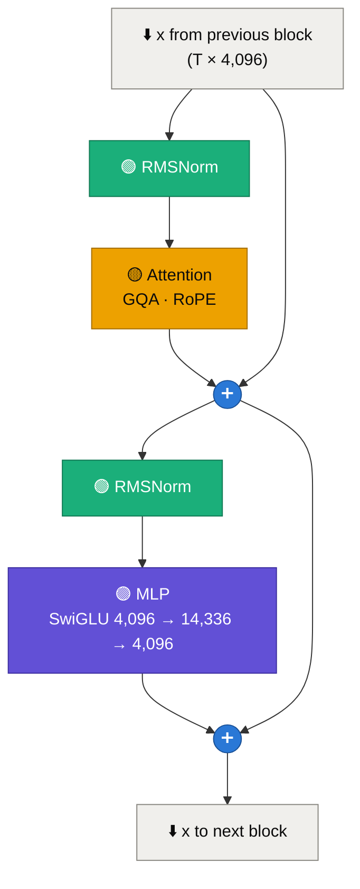
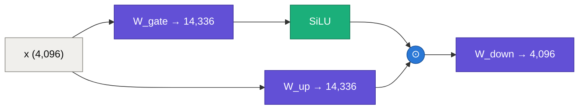
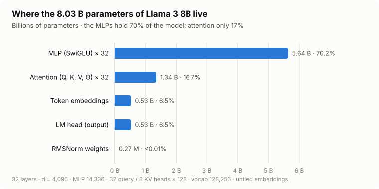

<div align="center">

# 🧱🔬 Inside a Transformer Block
### Norm, attention, MLP, residual: the four parts repeated 32 times in Llama 3 8B


✍️ by **Ashwini Rathi** · [@arathi-hlab](https://github.com/arathi-hlab)

<a href="https://github.com/arathi-hlab/llm-inference-zero-to-hero"></a>

</div>

<p align="center">⬅️ <a href="01-tokens-embeddings-logits.md">01 · Tokens, embeddings & logits</a> &nbsp;·&nbsp; 🏠 <a href="../README.md">Roadmap</a> &nbsp;·&nbsp; <a href="04-kv-caching-explained.md">04 · KV caching</a> ➡️</p>

> [!TIP]
> **TL;DR:** A decoder block does two things: **attention** lets each token gather information from earlier tokens, and an **MLP** processes each token on its own.
> Each is wrapped as `x = x + f(norm(x))`. Llama 3 8B stacks **32** identical blocks.
> The MLPs hold **70%** of the 8 B parameters, and at batch size 1 reading all those weights, not the maths, sets the speed limit.

---

## 🗺️ Contents

| | Section | | Section |
|---|---|---|---|
| 🔵 | [1. The block in one picture](#-1-the-block-in-one-picture) | 🟣 | [5. The MLP: SwiGLU](#-5-the-mlp-swiglu) |
| 🟠 | [2. The residual stream](#-2-the-residual-stream) | 🔴 | [6. Where the 8 B parameters live](#-6-where-the-8-b-parameters-live) |
| 🟢 | [3. RMSNorm](#-3-rmsnorm) | 🔷 | [7. Cost per token: FLOPs and bytes](#-7-cost-per-token-flops-and-bytes) |
| 🟡 | [4. Attention with GQA and RoPE](#-4-attention-with-gqa-and-rope) | ⭐ | [Cheat sheet](#-cheat-sheet) |

---

## 🔵 1. The block in one picture



In two lines of maths:

$$
\begin{aligned}
x &\leftarrow x + \color{#a56f00}{\text{Attention}}\big(\color{#1baf7a}{\text{RMSNorm}}(x)\big) \\
x &\leftarrow x + \color{#6250d6}{\text{MLP}}\big(\color{#1baf7a}{\text{RMSNorm}}(x)\big)
\end{aligned}
$$

| ⚙️ Llama 3 8B setting | Value |
|---|---|
| blocks $L$ | 32 |
| hidden size $d$ | 4,096 |
| query heads / KV heads | 32 / 8 |
| head dim $d_h$ | 128 |
| MLP size $d_{ff}$ | 14,336 |
| norm | RMSNorm, $\varepsilon = 10^{-5}$ |
| positions | RoPE, $\theta = 500{,}000$ |

---

## 🟠 2. The residual stream

Look at the `➕` nodes: each sub-layer **adds** its result to $x$ instead of replacing it.
Think of $x$ as a **shared notebook** of 4,096 numbers per token. It travels through all 32 blocks; every attention and MLP reads it, then writes a small correction back.

| Why add instead of replace? | |
|---|---|
| 🛣️ gradients flow straight through the `+` during training | deep stacks (32 to 100+ blocks) stay trainable |
| 🧩 each block only has to learn a **small edit** | not a full re-write of the representation |
| 🔍 the stream keeps the same shape everywhere | $T \times 4{,}096$ in, $T \times 4{,}096$ out, so blocks are interchangeable |

> [!NOTE]
> Serving kernels exploit this. SGLang fuses the residual **add** with the **next RMSNorm** into one kernel (`fused_add_rmsnorm`), so $x$ is read from memory once instead of twice.

---

## 🟢 3. RMSNorm

Before each sub-layer, the token's vector is rescaled to a steady size, so no block sees wildly growing numbers:

$$
\color{#1baf7a}{\text{RMSNorm}(x) = \frac{x}{\sqrt{\tfrac{1}{d}\sum_{i=1}^{d} x_i^2 + \varepsilon}} \odot g}
$$

- Divide by the **root-mean-square** of the 4,096 numbers, then multiply by a learned gain $g$ (4,096 parameters).
- Unlike LayerNorm, there is **no mean subtraction and no bias**: cheaper, and works just as well for LLMs.
- This is the **pre-norm** layout: norm *before* the sub-layer, on the branch, never on the residual stream itself.

Two norms per block plus one final norm = $2 \times 32 \times 4{,}096 + 4{,}096 =$ **266,240** parameters. Rounding error next to 8 B, but each one runs on every token.

---

## 🟡 4. Attention with GQA and RoPE

Attention is the **only** place where tokens talk to each other. The full maths is in [chapter 04, section 1](04-kv-caching-explained.md#-1-attention-in-60-seconds). Here is the plumbing:

| Matrix | Shape | Parameters | Role |
|---|---|---:|---|
| $W_Q$ | 4,096 × 4,096 | 16.8 M | 32 query heads × 128 |
| $W_K$ | 4,096 × 1,024 | 4.2 M | **8** key heads × 128 |
| $W_V$ | 4,096 × 1,024 | 4.2 M | **8** value heads × 128 |
| $W_O$ | 4,096 × 4,096 | 16.8 M | mixes the 32 head outputs back to $d$ |
| **per block** | | **41.9 M** | |

- 👥 **Grouped-Query Attention (GQA):** 4 query heads share each K/V head. $W_K$ and $W_V$ are ¼ the size of $W_Q$, and so is the KV cache. That's the 4× memory saving shown in chapter 04.
- 🌀 **RoPE:** before scores are computed, each $q$ and $k$ is **rotated** by an angle proportional to its position. The dot product $q \cdot k$ then depends on the **distance** between the two tokens. This is how a model with no position embeddings knows word order.
- 🎭 **Causal mask:** token $i$ only attends to tokens $\le i$.

---

## 🟣 5. The MLP: SwiGLU

Attention moves information **between** tokens. The MLP then works on **each token separately**. Many interpretability studies find this is where much of a model's stored knowledge sits.

Llama uses a **gated** MLP called SwiGLU, with three matrices instead of two:

$$
\color{#6250d6}{\text{MLP}(x) = \Big(\text{SiLU}(x\,W_{\text{gate}}) \;\odot\; x\,W_{\text{up}}\Big)\,W_{\text{down}}}
\qquad \text{SiLU}(a) = a \cdot \sigma(a)
$$



- The **gate** branch decides, per hidden unit, how much of the **up** branch passes through.
- Parameters per block: $3 \times 4{,}096 \times 14{,}336 =$ **176.2 M**, over **4×** the attention block.
- In serving code $W_{\text{gate}}$ and $W_{\text{up}}$ are stored side by side (`gate_up_proj`), so one GEMM produces both halves, then a fused `silu_and_mul` kernel combines them.

> [!IMPORTANT]
> In a **Mixture-of-Experts** model (DeepSeek, Qwen3-MoE, Mixtral), this MLP is replaced by many expert MLPs plus a router that picks a few per token.
> Attention stays the same. That's why MoE kernels are all about this one box.

---

## 🔴 6. Where the 8 B parameters live

<p align="center">
<picture>
  <source media="(prefers-color-scheme: dark)" srcset="../assets/llama3-8b-params-dark.svg">
  
</picture>
</p>

<details>
<summary>📋 Data table for this chart</summary>

| Component | Formula | Parameters | Share |
|---|---|---:|---:|
| MLP × 32 | $32 \times 3 \times 4{,}096 \times 14{,}336$ | 5,637,144,576 | 70.2% |
| Attention × 32 | $32 \times 41{,}943{,}040$ | 1,342,177,280 | 16.7% |
| Token embeddings | $128{,}256 \times 4{,}096$ | 525,336,576 | 6.5% |
| LM head | $4{,}096 \times 128{,}256$ | 525,336,576 | 6.5% |
| RMSNorm weights | $65 \times 4{,}096$ | 266,240 | <0.01% |
| **Total** | | **8,030,261,248** | 100% |

</details>

The total matches the "8 B" in the name. In **bf16** (2 bytes each) that's **16.06 GB ≈ 14.96 GiB** of weights before a single token of KV cache.

---

## 🔷 7. Cost per token: FLOPs and bytes

**Compute.** Each weight is used in one multiply-add per token (2 FLOPs). The embedding is a lookup, not a matmul, so:

$$
\text{FLOPs per token} \approx 2 \times (8.03\text{ B} - 0.53\text{ B}) \approx \color{#2a78d6}{\mathbf{15\ GFLOPs}}
\quad + \text{attention scores } (4Td \text{ per layer, chapter 04})
$$

**Memory traffic.** When the model decodes **one** request, every one of those weights must be read from GPU memory **for every token**:

$$
\frac{16.06\ \text{GB of weights}}{456\ \text{GB/s (Intel Arc Pro B60 peak)}} \approx \color{#e34948}{\mathbf{35\ ms\ per\ token}} \;\Rightarrow\; \le \mathbf{28\ tokens/s}
$$

> [!CAUTION]
> That's a **ceiling** from peak bandwidth, not a measurement. Real kernels reach only part of peak, and the KV cache adds more bytes per token.

That's ~1 FLOP per byte read, far below what the GPU's matrix engines can chew through. At batch size 1, decode is **memory-bandwidth-bound**: the maths units mostly wait for weights to arrive. The rest of this course is largely about fixing that:

| Trick | What it changes | Chapter |
|---|---|---|
| 🗄️ KV cache | stop recomputing old tokens | [04](04-kv-caching-explained.md) |
| 🧮 quantization | fewer bytes per weight (fp8 = ½, int4 = ¼) | 07 |
| 📦 continuous batching | read the weights once, use them for many requests | 09 |
| 🔮 speculative decoding | verify several tokens per weight read | 13 |

---

## ⭐ Cheat sheet

```text
block      : x += Attn(RMSNorm(x)) ;  x += MLP(RMSNorm(x))      × 32
RMSNorm    : x / rms(x) · g                                      (no mean, no bias)
attention  : Wq 4096×4096 · Wk,Wv 4096×1024 (GQA) · Wo · RoPE    41.9 M / block
MLP        : (SiLU(x·Wgate) ⊙ x·Wup) · Wdown, 4096→14336→4096    176.2 M / block
params     : MLP 70% · attention 17% · embed 6.5% · LM head 6.5% = 8.03 B
bf16 size  : 16.06 GB  →  batch-1 decode ≈ bandwidth / 16 GB tokens/s (≤ 28 tok/s on B60)
```

> [!TIP]
> 🗣️ **One-liner:** *"Attention mixes tokens, the MLP thinks about each token, and the residual stream carries the notes between them."*

---

## 📚 Further reading

- 📄 Vaswani et al., [*Attention Is All You Need*](https://arxiv.org/abs/1706.03762) (2017)
- 🟢 Zhang & Sennrich, [*Root Mean Square Layer Normalization*](https://arxiv.org/abs/1910.07467) (2019)
- 🟣 Shazeer, [*GLU Variants Improve Transformer*](https://arxiv.org/abs/2002.05202) (2020)
- 👥 Ainslie et al., [*GQA*](https://aclanthology.org/2023.emnlp-main.298/) (2023)
- 🔭 Elhage et al., [*A Mathematical Framework for Transformer Circuits*](https://transformer-circuits.pub/2021/framework/index.html) (2021), the residual-stream view
- 🦙 Meta, [*The Llama 3 Herd of Models*](https://arxiv.org/abs/2407.21783) (2024)

<p align="center">⬅️ <a href="01-tokens-embeddings-logits.md">01 · Tokens, embeddings & logits</a> &nbsp;·&nbsp; 🏠 <a href="../README.md">Roadmap</a> &nbsp;·&nbsp; <a href="04-kv-caching-explained.md">04 · KV caching</a> ➡️</p>

<div align="center">

---

### ✍️ About the author

**Ashwini Rathi** · [@arathi-hlab](https://github.com/arathi-hlab)
*Working on LLM inference & SGLang on Intel GPUs*

**If this helped, please give the repo a star. It really helps! 💛**

<a href="https://github.com/arathi-hlab/llm-inference-zero-to-hero"></a>

</div>
