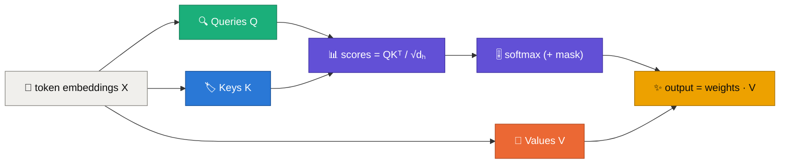
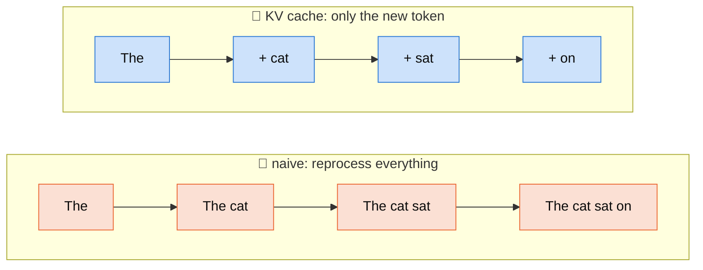
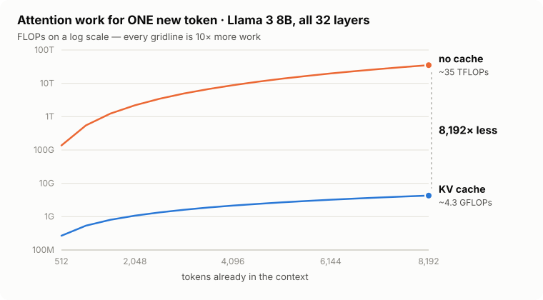
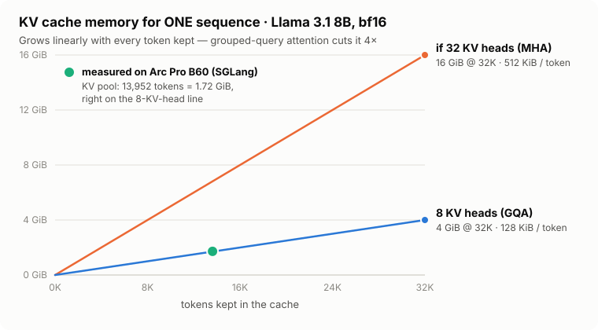

<div align="center">

# 🧠⚡ KV Caching, Explained
### How LLMs avoid re-reading the whole conversation for every new word


✍️ by **Ashwini Rathi** · [@arathi-hlab](https://github.com/arathi-hlab)

<a href="https://github.com/arathi-hlab/sglang-guidance"></a>

</div>

<p align="center">⬅️ <a href="02-inside-a-transformer-block.md">02 · Inside a transformer block</a> &nbsp;·&nbsp; 🏠 <a href="../README.md">Roadmap</a> &nbsp;·&nbsp; 05 · Prefill vs decode (coming soon) ➡️</p>

> [!TIP]
> **TL;DR:** When an LLM writes word #1,001, words #1 to #1,000 haven't changed. Their **Keys** and **Values** haven't either.
> So the model saves them once (the **KV cache**) and reuses them. Each new token then costs **linear** attention work instead of **quadratic**.
> The price is **GPU memory**: about **128 KiB per token** for Llama 3 8B.

---

## 🗺️ Contents

| | Section | | Section |
|---|---|---|---|
| 🔵 | [1. Attention in 60 seconds](#-1-attention-in-60-seconds) | 🟣 | [6. How much work is saved](#-6-how-much-work-is-saved) |
| 🟠 | [2. What attention costs](#-2-what-attention-costs) | 🔴 | [7. Llama 3 8B, by the numbers](#-7-llama-3-8b-by-the-numbers) |
| 🟢 | [3. The hidden waste in text generation](#-3-the-hidden-waste-in-text-generation) | 🟤 | [8. Benefits and the bill](#-8-benefits-and-the-bill) |
| 🟡 | [4. Causal attention: the past is frozen](#-4-causal-attention-the-past-is-frozen) | ⚪ | [9. Which models can use it?](#-9-which-models-can-use-it) |
| 🔷 | [5. The KV cache itself](#-5-the-kv-cache-itself) | ⭐ | [Cheat sheet & further reading](#-cheat-sheet) |

---

## 🔵 1. Attention in 60 seconds

Think of every token as a person at a meetup, wearing three badges:

| Badge | Symbol | The question it answers |
|---|---|---|
| 🔍 **Query** | $\color{#1baf7a}{Q}$ | *"What am I looking for?"* |
| 🏷️ **Key** | $\color{#2a78d6}{K}$ | *"What do I have that others might want?"* |
| 🎁 **Value** | $\color{#eb6834}{V}$ | *"If you pick me, here's what I hand over."* |

All three are just the token's embedding $X$ multiplied by learned weight matrices:

$$
\color{#1baf7a}{Q = XW_Q} \qquad \color{#2a78d6}{K = XW_K} \qquad \color{#eb6834}{V = XW_V}
$$

To update one token, its Query is compared with every Key it is allowed to see. The scores become weights, and the weights blend the Values:

$$
\text{Attention}(Q,K,V) = \text{softmax}\!\left(\frac{\color{#1baf7a}{Q}\,\color{#2a78d6}{K^\top}}{\sqrt{d_h}} + M\right)\color{#eb6834}{V}
$$



- **$\sqrt{d_h}$** keeps dot products from getting huge as the head dimension $d_h$ grows. Without it, softmax would saturate.
- **$M$** is the mask. More on it in [section 4](#-4-causal-attention-the-past-is-frozen).
- Real models run many **heads** side by side. Each head learns its own pattern, and their outputs are concatenated and projected back to the model width $d$.

---

## 🟠 2. What attention costs

Counting one multiply plus one add as **2 FLOPs**, for a sequence of $T$ tokens and one head of size $d_h$:

| Step | Shape | FLOPs |
|---|---|---|
| $\color{#1baf7a}{Q}\color{#2a78d6}{K^\top}$ | $(T\times d_h)(d_h\times T) \rightarrow T\times T$ | $\approx 2T^2d_h$ |
| weights $\cdot\, \color{#eb6834}{V}$ | $(T\times T)(T\times d_h) \rightarrow T\times d_h$ | $\approx 2T^2d_h$ |
| **Total, all $H$ heads** ($d = H d_h$) | | $\approx \mathbf{4T^2d}$ 🔥 |

> [!IMPORTANT]
> Attention scores grow with **$T^2$**: double the context and you do **~4×** the work.
> The Q/K/V and output projections ($\approx 8Td^2$ FLOPs) grow only **linearly** in $T$.

**Memory hits too.** One score matrix holds $H \times T^2$ numbers. With 32 heads, 8,192 tokens and 2-byte bf16:

$$
32 \times 8{,}192^2 \times 2\ \text{bytes} = \color{#e34948}{\mathbf{4\ GiB}}\ \text{for a single layer's score matrix}
$$

*(Kernels like FlashAttention never build this matrix in full, but the arithmetic still has to happen.)*

---

## 🟢 3. The hidden waste in text generation

LLMs write **one token at a time**, and every new token is fed back in. A naive loop looks like this:

| Step | 📥 model sees | 📤 predicts |
|---|---|---|
| 1 | `The` | `cat` |
| 2 | `The cat` | `sat` |
| 3 | `The cat sat` | `on` |
| 4 | `The cat sat on` | `the` |



"The" gets processed again at **every single step**. Over $N$ steps the model handles

$$
1 + 2 + \dots + N = \frac{N(N+1)}{2}\ \text{token positions}
$$

> [!WARNING]
> For a 1,000-token answer that's **500,500** token passes for only **1,000** real tokens.
> And since full attention over a prefix of length $t$ costs $\propto t^2$, the total attention work is
> $\sum_{t=1}^{N} t^2 = \frac{N(N+1)(2N+1)}{6} = \color{#e34948}{\Theta(N^3)}$ 😱

---

## 🟡 4. Causal attention: the past is frozen

Decoder-only models (GPT, Llama, Qwen…) use **causal** attention: a token may look at itself and **earlier** tokens, never later ones.

| query ↓ / key → | The | cat | sat | on |
|---|:-:|:-:|:-:|:-:|
| **The** | 🟩 | ⬛ | ⬛ | ⬛ |
| **cat** | 🟩 | 🟩 | ⬛ | ⬛ |
| **sat** | 🟩 | 🟩 | 🟩 | ⬛ |
| **on**  | 🟩 | 🟩 | 🟩 | 🟩 |

🟩 allowed (mask $= 0$) · ⬛ blocked (mask $= -\infty$, so its softmax weight becomes 0)

$$
M_{ij} = \begin{cases} \color{#1baf7a}{0} & j \le i \\ \color{#e34948}{-\infty} & j > i \end{cases}
$$

> [!NOTE]
> 💡 **The key insight:** adding "on" changes **nothing** for "The", "cat" or "sat", because they're not allowed to look at it.
> Their outputs, and therefore their **Keys and Values, are final**. Anything final can be stored and reused.

---

## 🔷 5. The KV cache itself

<p align="center">
<picture>
  <source media="(prefers-color-scheme: dark)" srcset="../assets/decode-step-dark.svg">
  
</picture>
</p>

When token $t$ arrives, each layer does exactly four things:

1. 🧮 **Project only the new token:** $\color{#1baf7a}{q_t}=x_tW_Q,\ \color{#2a78d6}{k_t}=x_tW_K,\ \color{#eb6834}{v_t}=x_tW_V$
2. ➕ **Append** $\color{#2a78d6}{k_t}$ and $\color{#eb6834}{v_t}$ to that layer's cache
3. 🎯 **Attend** with the single new query over everything cached:

$$
\boxed{\;o_t = \text{softmax}\!\left(\frac{\color{#1baf7a}{q_t}\,\color{#2a78d6}{K_{1:t}^\top}}{\sqrt{d_h}}\right)\color{#eb6834}{V_{1:t}}\;}
$$

4. ➡️ Pass $o_t$ on to the next layer, which has **its own** cache. Llama 3 8B keeps **32** of them.

No mask is needed in step 3: the newest token is allowed to see every position that exists so far.

### 🤔 Why cache K and V but not Q?

| | Needed again later? | Why |
|---|:-:|---|
| $\color{#2a78d6}{\textbf{Keys}}$ | ✅ yes | every **future** query compares against them |
| $\color{#eb6834}{\textbf{Values}}$ | ✅ yes | every **future** output blends them |
| $\color{#1baf7a}{\textbf{Queries}}$ | ❌ no | a query only produces **its own** token's output, and that output is already done |

---

## 🟣 6. How much work is saved

With the cache, one new query meets $T$ keys: $(1\times d_h)(d_h \times T)$, and then $(1\times T)(T\times d_h)$:

$$
\underbrace{4T^2d}_{\color{#eb6834}{\text{recompute everything}}} \;\longrightarrow\; \underbrace{4Td}_{\color{#2a78d6}{\text{with KV cache}}}\quad\text{attention FLOPs per new token}
$$

<p align="center">
<picture>
  <source media="(prefers-color-scheme: dark)" srcset="../assets/attention-flops-dark.svg">
  
</picture>
</p>

<details>
<summary>📋 Data table for this chart</summary>

| context $T$ | 🟠 no cache (FLOPs / token) | 🔵 KV cache (FLOPs / token) | saving |
|---:|---:|---:|---:|
| 512 | 137 G | 268 M | 512× |
| 2,048 | 2.2 T | 1.1 G | 2,048× |
| 4,096 | 8.8 T | 2.1 G | 4,096× |
| 8,192 | 35 T | 4.3 G | 8,192× |

Llama 3 8B: 32 layers × 32 query heads × $d_h$ = 128. Attention score and value math only; the saving factor equals $T$.
</details>

| Generating $N$ tokens | 🐢 without cache | 🚀 with cache |
|---|:-:|:-:|
| attention per new token | $O(T^2d)$ | $O(Td)$ |
| attention for the whole answer | $O(N^3)$ | $O(N^2)$ |
| projections + MLP | redone for **all** tokens, every step | **new token only** |

> [!CAUTION]
> The cache doesn't make the **first** pass over your prompt (the *prefill*) cheaper. That's still $O(T^2)$.
> What it removes is **doing that work again** for every generated token.

---

## 🔴 7. Llama 3 8B, by the numbers

| ⚙️ Setting | Value |
|---|---|
| layers $L$ | 32 |
| hidden size $d$ | 4,096 |
| query heads | 32 |
| **KV heads $H_{KV}$** | **8** (Grouped-Query Attention: 4 query heads share one K/V head) |
| head dim $d_h$ | 128 |

**Compute** at 8,192 tokens of context, per new token:
$4 \times 8{,}192 \times 32 \times 128 = 134\text{M FLOPs per layer} \;\Rightarrow\; \times 32 \text{ layers} \approx \color{#2a78d6}{\mathbf{4.3\ GFLOPs}}$

> GQA doesn't reduce this number, because all 32 **query** heads still do attention. Its win is **memory**, as shown below.

**Memory.** The cache keeps **K and V** for every token, every layer:

$$
\color{#6250d6}{\boxed{\;M_{KV} = 2 \cdot L \cdot T \cdot H_{KV} \cdot d_h \cdot b \cdot B\;}}
$$

| symbol | meaning | Llama 3 8B |
|---|---|---|
| $2$ | K **and** V | 2 |
| $L$ | layers | 32 |
| $T$ | tokens kept | 8,192 |
| $H_{KV}$ | KV heads | 8 |
| $d_h$ | head dim | 128 |
| $b$ | bytes per number (bf16) | 2 |
| $B$ | batch size | 1 |

$$
2 \times 32 \times 8{,}192 \times 8 \times 128 \times 2 = 1{,}073{,}741{,}824\ \text{bytes} = \color{#2a78d6}{\mathbf{1\ GiB}}
\qquad\Rightarrow\qquad \color{#2a78d6}{\mathbf{128\ KiB\ per\ token}}
$$

<p align="center">
<picture>
  <source media="(prefers-color-scheme: dark)" srcset="../assets/kv-memory-dark.svg">
  
</picture>
</p>

<details>
<summary>📋 Data table for this chart</summary>

| tokens kept | 🔵 8 KV heads (GQA) | 🟠 if 32 KV heads (MHA) |
|---:|---:|---:|
| 8,192 | 1 GiB | 4 GiB |
| 16,384 | 2 GiB | 8 GiB |
| 32,768 | 4 GiB | 16 GiB |
| 🟢 13,952 (measured) | 1.72 GiB | — |

</details>

> [!NOTE]
> 🧪 **Checked on real hardware.** On an **Intel Arc Pro B60 (24 GB)**, SGLang serving `meta-llama/Llama-3.1-8B-Instruct` with `--mem-fraction-static 0.70`
> reported a KV pool of **13,952 tokens, K = 0.86 GB + V = 0.86 GB**.
> The formula gives $13{,}952 \times 128\ \text{KiB} = 1.70\ \text{GiB}$, right on the line. 🎯
> Raise `--mem-fraction-static` (more room for the pool) or use `--kv-cache-dtype fp8_e4m3` (half the bytes per number) to fit more tokens.

With classic multi-head attention (32 KV heads), the same 8K context would need **4 GiB**. That 4× saving is why almost every modern LLM uses GQA. 🙌

---

## 🟤 8. Benefits and the bill

| 🎉 What you gain | 🧾 What you pay |
|---|---|
| ♻️ No recomputing the past at every step | 💾 Memory that grows **linearly** with every token kept |
| ⚡ Lower per-token latency, higher throughput | 🚚 The cache must be **read back** at every step, so decode becomes memory-bandwidth-bound |
| 🏗️ The foundation for serving tricks: prefix caching, PagedAttention, KV quantization, sliding windows | 🧮 With long contexts × many users, the cache, not the weights, decides how many requests fit |

> [!NOTE]
> FLOPs saved on paper ≠ the same % saved in wall-clock time. Real speed-ups depend on model, batch size, context length, hardware and kernels.

**Two optimizations people often mix up:**

| | ⚡ FlashAttention | 🗄️ KV caching |
|---|---|---|
| Fixes | memory traffic **inside** one attention computation | **repeating** attention across generation steps |
| How | tiles the math, never stores the $T\times T$ matrix | stores K/V once, reuses them forever |
| Together? | ✅ yes, they stack | ✅ yes |

---

## ⚪ 9. Which models can use it?

The rule is simple: **cached K/V must stay valid when new tokens arrive.**

| Architecture | KV cache? | Why |
|---|:-:|---|
| 🦙 Decoder-only (GPT, Llama, Qwen) | ✅ | causal mask freezes the past |
| 🔁 Encoder-decoder (T5, Whisper) | ✅ | decoder self-attention is causal, and cross-attention K/V come from a fixed encoder output |
| 🔄 Bidirectional encoder (BERT) | ❌ (not append-only) | every token sees every other one, so a new token changes old representations |

---

## ⭐ Cheat sheet

```text
🔍 Q  = what am I looking for        → computed for the NEW token only
🏷️ K  = what do I offer               → cached, appended every step
🎁 V  = what do I hand over           → cached, appended every step

attention / new token :  4·T²·d  ──KV cache──▶  4·T·d
whole answer (N tokens):  O(N³)   ──KV cache──▶  O(N²)
KV memory             :  2 · layers · tokens · kv_heads · head_dim · bytes · batch
Llama 3 8B (bf16)     :  128 KiB per token  ·  1 GiB per 8K tokens
```

> [!TIP]
> 🗣️ **One-liner for your next interview:** *"The model still needs to **see** the past, but it never needs to **recompute** it."*

---

## 📚 Further reading

- 📄 Vaswani et al., [*Attention Is All You Need*](https://arxiv.org/abs/1706.03762) (2017)
- 🤗 Hugging Face, [KV cache strategies](https://huggingface.co/docs/transformers/kv_cache) · [KV cache from scratch](https://huggingface.co/blog/kv-cache)
- ⚡ Dao et al., [*FlashAttention*](https://arxiv.org/abs/2205.14135) (2022)
- 👥 Ainslie et al., [*GQA*](https://aclanthology.org/2023.emnlp-main.298/) (2023)
- 📦 Kwon et al., [*PagedAttention / vLLM*](https://doi.org/10.1145/3600006.3613165) (2023)
- 🚀 [SGLang](https://github.com/sgl-project/sglang): RadixAttention reuses KV cache across requests that share a prefix

<p align="center">⬅️ <a href="02-inside-a-transformer-block.md">02 · Inside a transformer block</a> &nbsp;·&nbsp; 🏠 <a href="../README.md">Roadmap</a> &nbsp;·&nbsp; 05 · Prefill vs decode (coming soon) ➡️</p>

<div align="center">

---

### ✍️ About the author

**Ashwini Rathi** · [@arathi-hlab](https://github.com/arathi-hlab)
*Working on LLM inference & SGLang on Intel GPUs*

**If this helped you understand KV caching, please give the repo a star. It really helps! 💛**

<a href="https://github.com/arathi-hlab/sglang-guidance"></a>

[](https://github.com/arathi-hlab/sglang-guidance/stargazers)
[](https://github.com/arathi-hlab)

</div>
